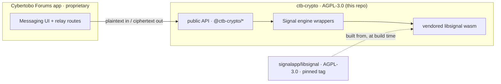

# 🔐 ctb-crypto

### The end-to-end encryption core behind [Cybertobo Forums](https://forums.cybertobo.com)

Post-quantum, forward-secret private messaging built on the **Signal Protocol** — the same audited cryptography used by Signal, WhatsApp, and Google Messages.

 

---

> **What this is:** the isolated cryptography layer that powers end-to-end encrypted direct messages on Cybertobo Forums. It is published as open source because it is a work based on [libsignal](https://github.com/signalapp/libsignal) (AGPL-3.0), and Cybertobo Forums serves it over a network — so AGPL §13 requires its corresponding source to be available to users. This repository *is* that source.
>
> **What this is not:** a general-purpose messaging SDK, and not the Cybertobo Forums application (which is a separate, proprietary work that consumes this layer only through its public interface).

## ✨ Security guarantees

| Property | How |
|---|---|
| 🔒 **End-to-end encryption** | Message keys exist only on client devices — the server stores nothing but opaque ciphertext. |
| ⏩ **Forward secrecy** | Signal **Double Ratchet** — every message uses a fresh key; a compromised key can't decrypt past messages. |
| 🔁 **Post-compromise security** | The ratchet self-heals, so a compromise doesn't grant indefinite access. |
| 🛡️ **Post-quantum handshake** | **PQXDH** (hybrid X25519 + ML-KEM/Kyber) resists "harvest-now, decrypt-later" attacks. |
| 🕵️ **Sealed sender** | The relay doesn't learn *who* sent a 1:1 message (metadata minimization). |
| 👥 **Group encryption** | **SenderKey** — one encryption fans out to every member; reactions included. |
| 🗝️ **Recovery-key backup** | Signal **Account Entropy Pool** → `BackupKey`; history restores on a new device with the recovery key only. Lose it → unrecoverable, not even by us. |

## 🧱 Architecture — a clean, auditable boundary

The proprietary forum app never touches libsignal directly. It talks *only* to this package's public interface; this package never imports app code. That boundary is what keeps the crypto independently auditable — and lets *only* this layer be AGPL while the product stays separate.

- Keys, sessions, and decrypted history live **only in the browser** (IndexedDB) — never in the server database.
- The server is a pure relay: it stores public prekey material + opaque ciphertext, and can never decrypt anything.

## 📦 What's inside

| Path | Purpose |
|---|---|
| `src/crypto-engine.ts` | App-facing boundary over the libsignal wasm engine |
| `src/signal-messaging.ts` | Double-Ratchet + SenderKey + sealed-sender send/receive |
| `src/signal-store.ts` | IndexedDB-backed libsignal store traits (client) |
| `src/signal-wire.ts` | `sig1:` / `sss1:` wire packing |
| `src/provision.ts` | Client device provisioning (identity + X25519 + Kyber prekeys) |
| `src/pm-backup.ts` | Account-Entropy-Pool recovery-key backup (AES-256-CBC + HMAC) |
| `src/server-signal-engine.ts` | Server-side sealed-sender certificate authority |
| `src/engine/` | Vendored `wasm-bindgen` glue (generated) |
| `wasm/` | Rust wrapper crate + build recipe (`build-signal-wasm.sh`, `vendor-signal-wasm.mjs`) that compile libsignal → wasm |

The compiled wasm binary ships as a static asset (`/pm/signal-engine_bg.wasm`). The Rust wrapper crate + build recipe that produce it live in **`wasm/`** in this package (`wasm/signal-wasm/`, `wasm/build-signal-wasm.sh`, `wasm/vendor-signal-wasm.mjs`) — the complete corresponding source for the wasm engine.

## 🔄 Staying current with upstream

This layer is **pinned** to a specific libsignal release and pulls it **directly from upstream at build time** — no fork, no divergence. A weekly CI watcher compares the pinned tag to the latest [`signalapp/libsignal`](https://github.com/signalapp/libsignal) release and opens a bump PR (with a `cargo audit` pass and a backup-derivation compatibility gate), so security fixes reach production quickly without forking away from Signal's audited source.

> **Current pinned version:** `libsignal v0.99.0`

## ⚖️ License & corresponding source (AGPL-3.0)

This package is licensed under the **GNU Affero General Public License v3.0** — see [`LICENSE`](./LICENSE) and [`NOTICE`](./NOTICE).

- **Base library:** [signalapp/libsignal](https://github.com/signalapp/libsignal) — AGPL-3.0-only, © Signal Messenger, LLC. Unmodified upstream source lives there.
- **This repository** contains Cybertobo's build recipe, vendored wasm glue, and thin integration wrappers around libsignal's API — the corresponding source offered under AGPL §13.
- The proprietary Cybertobo Forums application is a **separate work**, not covered by this license.

## ⚠️ Disclaimer

Distributed **WITHOUT ANY WARRANTY**; see sections 15 and 16 of the [`LICENSE`](./LICENSE). Cryptography is hard — independent review is welcome and encouraged.

 

Made for <a href="https://forums.cybertobo.com"><b>Cybertobo Forums</b></a> — privacy-first community software.

